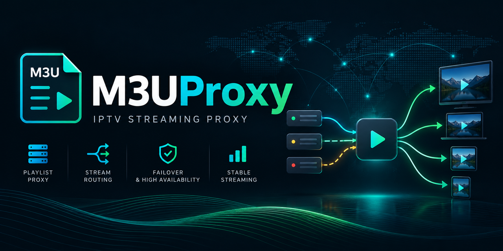

<div align="center">
  
</div>

# M3U Proxy

M3U Proxy is a Windows console application that downloads IPTV playlists and EPG data through Google Chrome and can expose the same provider through a local, Xtream-compatible proxy.

M3U Proxy is a client-compatibility tool for IPTV sources that the user is **lawfully entitled and authorized to access through a proxy**. Some servers respond differently to browsers and other HTTP clients. M3U Proxy uses Chrome for upstream requests and presents a conventional local HTTP endpoint to the IPTV player. Browser-based requests do not grant additional access rights or permission to bypass a provider's restrictions.

The application is not an IPTV service: it has no built-in channel catalogue, does not sell subscriptions or streaming rights, and does not itself authorize access to media. Provider URLs and access details are read from configuration maintained by the person deploying it. Any shared example configuration should contain fictional, non-working placeholders only.

> [!IMPORTANT]
> **For lawful and authorized use only.** M3U Proxy is a general-purpose software utility, **not an IPTV service**. Users must have all necessary rights and permissions to access, proxy, and play the content they configure, and must comply with applicable laws and provider terms. Illegal streaming, unauthorized redistribution, and circumvention of access or content protections are neither intended nor authorized by this project. **The user is responsible for their own configuration and use; the developer does not operate, verify, or control third-party IPTV services or the content they offer.** See [Legal use and responsibility](#legal-use-and-responsibility).

## What it does

The application has two modes:

- **Download M3U files** downloads the configured M3U and XMLTV files through headless Google Chrome.
- **Start proxy** starts a local HTTP server that behaves like the relevant parts of an Xtream server.

Proxy mode provides:

- Xtream authentication and API forwarding through Chrome
- Movie and series category forwarding
- Movie, series, live, and timeshift stream forwarding
- HTTP Range forwarding for seeking and resuming VOD
- Rewriting of provider URLs to the configured local proxy address
- Local serving of previously downloaded M3U and XMLTV files
- Multiple provider sources, selected by their username and password
- Credential-safe console request logging

## Why a proxy is necessary

Some IPTV servers respond differently depending on the network client. A provider may return a valid response to Chrome while returning an empty or prematurely closed response to .NET, libcurl, mpv, or an IPTV application's internal HTTP client.

Downloading an M3U file through Chrome solves only the first part of that problem. A player may still make separate Xtream calls for movie categories, series categories, stream metadata, and EPG information. Playback also connects to the media URLs embedded in the playlist.

Proxy mode covers those additional requests:

```text
IPTV player
       |
       | HTTP to 127.0.0.1:5050
       v
M3U Proxy
   |          |
   |          +--> Downloaded M3U and XMLTV files
   |
   +--> Headless Chrome --> IPTV provider API and media
```

The IPTV player sees a normal local Xtream server. The upstream provider sees requests made by Chrome.

## Requirements

- Windows
- .NET 10 SDK or runtime
- Google Chrome installed
- Valid access to an IPTV provider
- An IPTV player that supports M3U or Xtream sources

The project currently targets `net10.0` and launches the installed Google Chrome channel through Microsoft Playwright.

## Configuration

Configuration is stored in `M3UProxyApp/appsettings.json`.

Never publish a real configuration file containing provider credentials. Usernames and passwords embedded in playlist URLs should be treated as secrets.

### Example

```json
{
  "downloads": [
    {
      "name": "Example playlist",
      "url": "http://provider.example:8080/get.php?username=USER&password=PASSWORD&type=m3u_plus&output=ts",
      "filePath": "C:\\iptv\\example.m3u"
    },
    {
      "name": "Example EPG",
      "url": "http://provider.example:8080/xmltv.php?username=USER&password=PASSWORD",
      "filePath": "C:\\iptv\\example.xmltv"
    }
  ],
  "proxy": {
    "listenUrl": "http://127.0.0.1:5050",
    "publicBaseUrl": "http://127.0.0.1:5050",
    "serveDownloadedFiles": true,
    "downloadMaxAgeMinutes": 60,
    "sources": [
      {
        "name": "Example",
        "playlistDownload": "Example playlist",
        "epgDownload": "Example EPG"
      }
    ]
  }
}
```

### Download settings

Each entry under `downloads` has the following properties:

| Property | Description |
| --- | --- |
| `name` | A unique name used by the console and proxy source references. |
| `url` | The complete upstream M3U or XMLTV URL. |
| `filePath` | The local destination file. Parent directories are created automatically. |

Downloads run in parallel. Each download is first written to a temporary file and replaces the configured destination only after it completes successfully.

### Proxy settings

| Property | Description |
| --- | --- |
| `listenUrl` | The address Kestrel listens on. The default restricts access to the current computer. |
| `publicBaseUrl` | The address written into playlists and Xtream login responses. This is the address the IPTV player must be able to reach. |
| `serveDownloadedFiles` | When `true`, M3U and XMLTV responses come from the configured local files. When `false`, those responses are fetched upstream through Chrome. |
| `downloadMaxAgeMinutes` | The maximum age of downloaded files. A GET request for M3U or XMLTV automatically updates all configured downloads when any file is missing or has reached this age. Defaults to `60`. |
| `sources` | Providers available through the local proxy. |

Each proxy source references download entries by name:

| Property | Description |
| --- | --- |
| `name` | A display name used in console output and request logs. |
| `playlistDownload` | The name of the M3U entry under `downloads`. This entry supplies the upstream server and credentials. |
| `epgDownload` | The optional name of the XMLTV entry under `downloads`. |

The proxy extracts the upstream hostname, username, and password from the playlist URL. This avoids duplicating credentials in the proxy section.

Sources must have unique username and password combinations because Xtream stream URLs do not contain a separate source identifier.

### Access from another device

The default configuration listens only on `127.0.0.1`, which is appropriate when the player runs on the same computer.

For a player on another device, use settings similar to:

```json
{
  "listenUrl": "http://0.0.0.0:5050",
  "publicBaseUrl": "http://192.168.1.50:5050"
}
```

Replace `192.168.1.50` with the computer's LAN address. A Windows Firewall rule may also be required. Binding to all interfaces makes the proxy reachable from the network, so it should only be used on a trusted LAN.

## Building

From the repository root:

```powershell
dotnet restore M3UProxy.slnx
dotnet build M3UProxy.slnx
```

## Running

Start the application without arguments to open the menu:

```powershell
dotnet run --project M3UProxyApp
```

The menu offers:

1. `Download M3U files`
2. `Start proxy`

The modes can also be selected directly:

```powershell
dotnet run --project M3UProxyApp -- download
dotnet run --project M3UProxyApp -- proxy
```

The modes can also be passed as flags, which is useful in shortcuts and startup scripts:

```powershell
dotnet run --project M3UProxyApp -- --download
dotnet run --project M3UProxyApp -- --proxy
M3UProxyApp.exe --proxy
```

Press `Ctrl+C` to cancel downloads. In proxy mode, press `U` to update the configured M3U and XMLTV files. Press `Q` to exit the application, or use `Ctrl+C` as a fallback.

## Recommended workflow

When `serveDownloadedFiles` is `true`:

1. Run download mode to refresh the configured M3U and XMLTV files.
2. Exit after the downloads finish.
3. Start proxy mode.
4. Keep the proxy running while the IPTV player refreshes or plays content.
5. Stop the proxy when IPTV access is no longer needed.

The proxy does not watch the files or schedule downloads. An M3U or XMLTV request refreshes stale downloads according to `downloadMaxAgeMinutes`. You can also press `U` while the proxy is running or repeat the download step whenever an immediate refresh is required.

## Configuring a typical IPTV player

The exact labels vary between applications, but most IPTV players accept either an Xtream source or an M3U playlist. Xtream mode is recommended because it gives the player structured live, movie, series, and EPG data.

Add a new Xtream source with:

- **Server:** the configured `publicBaseUrl`, normally `http://127.0.0.1:5050`
- **Username:** the same username used in the upstream playlist URL
- **Password:** the same password used in the upstream playlist URL

The proxy rewrites the Xtream login response so the player continues using the local server for subsequent API and stream requests.

Alternatively, add the local M3U URL printed when proxy mode starts. Its format is:

```text
http://127.0.0.1:5050/get.php?username=USER&password=PASSWORD&type=m3u_plus&output=ts
```

The console redacts the password in the displayed URL. Replace the placeholder with the password from the configured upstream playlist.

## EPG behavior

When a proxy source has `epgDownload` configured, the proxy exposes the EPG at the conventional Xtream endpoint:

```text
http://127.0.0.1:5050/xmltv.php?username=USER&password=PASSWORD
```

An IPTV player using the local Xtream login will normally request this endpoint automatically, so a separate EPG entry should not be necessary.

With `serveDownloadedFiles` enabled, a GET request for M3U or XMLTV first checks the age of all configured download files. If any file is missing or has reached `downloadMaxAgeMinutes`, all downloads are refreshed before the requested file is served.

## What uses local files and what uses the provider

With the default `serveDownloadedFiles: true` configuration:

| Request | Source |
| --- | --- |
| M3U playlist | Local downloaded file |
| XMLTV EPG | Local downloaded file |
| Xtream login | Provider through Chrome |
| Live, movie, and series categories | Provider through Chrome |
| Movie and series metadata | Provider through Chrome |
| Live and VOD media | Provider through Chrome |

The proxy must therefore remain running during catalog refreshes and playback. It can be stopped when the IPTV player is not being used.

## Rate limits and polling

Be aware that frequent polling can trigger the provider's rate limits. This is commonly returned as HTTP `429 Too Many Requests`, although some providers use other status codes or temporarily close the connection instead.

Xtream login, category, metadata, and media requests still reach the upstream provider even when `serveDownloadedFiles` is enabled. Multiple players, short automatic refresh intervals, repeated manual refreshes, or monitoring tools can therefore generate more requests than expected.

To reduce the risk:

- Use reasonable playlist, category, and EPG refresh intervals.
- Avoid repeatedly pressing refresh while a previous refresh is still running.
- Avoid running several players or diagnostics tools against the same account simultaneously.
- Prefer the downloaded M3U and XMLTV files for data that does not need to be queried live.
- If the provider returns `429`, stop polling and wait before trying again. Follow the provider's documented limits when available.

The proxy does not attempt to bypass provider rate limits. A `429` response should be treated as an instruction to reduce request frequency.

## Request logging

Proxy mode writes a start and completion entry for every request. Logs include the request destination, request type, configured source name, result status, and duration. Raw URLs, usernames, and passwords are not printed.

- Cyan `LOCAL` entries are handled by the proxy, such as M3U and XMLTV responses served from downloaded files. Their completion entries include `file_source=CACHE` or `file_source=SERVER_REFRESH` and the resulting `file_age`.
- Orange `UPSTREAM` entries contact the configured provider, such as Xtream API requests and media streams.
- Requests with unknown credentials are `LOCAL` because they are rejected before an upstream connection is attempted.

Example:

```text
[2026-08-17 23:30:00] --> UPSTREAM GET Xtream get_vod_categories source=Example
[2026-08-17 23:30:01] <-- UPSTREAM GET Xtream get_vod_categories source=Example status=200 duration_ms=842
[2026-08-17 23:31:12] --> LOCAL GET M3U playlist source=Example
[2026-08-17 23:31:12] <-- LOCAL GET M3U playlist source=Example file_source=CACHE file_age=12m34s status=200 duration_ms=18
[2026-08-17 23:32:00] <-- LOCAL GET XMLTV EPG source=Example file_source=SERVER_REFRESH file_age=0s status=200 duration_ms=4321
[2026-08-17 23:33:13] --> UPSTREAM GET movie stream source=Example
```

A stream completion entry appears when playback ends or the player closes the connection.

## Local endpoints

The proxy implements the endpoints required by typical Xtream and M3U clients:

| Endpoint | Purpose |
| --- | --- |
| `/get.php` | M3U playlist |
| `/xmltv.php` | XMLTV EPG |
| `/player_api.php` | Xtream login, categories, listings, and metadata |
| `/live/{username}/{password}/...` | Live streams |
| `/movie/{username}/{password}/...` | Movie streams |
| `/series/{username}/{password}/...` | Series episodes |
| `/timeshift/{username}/{password}/...` | Catch-up streams |

Legacy stream paths beginning directly with the username and password are also forwarded.

## Troubleshooting

### The proxy says that the downloaded playlist or EPG was not found

Run download mode first and verify the configured `filePath`. Alternatively, set `serveDownloadedFiles` to `false` to fetch those responses through Chrome.

### Movie or series categories do not appear

Keep the proxy console open and refresh the playlist in the IPTV player. Look for `get_vod_categories`, `get_series_categories`, and their completion status in the console.

### Playback fails

Check the stream request status in the console:

- `200` or `206` indicates that the provider returned media.
- `401` indicates unknown credentials at the local proxy.
- `4xx` or `5xx` from upstream usually indicates an account, provider, availability, or connection problem.
- Local `502` means the proxy could not complete the upstream Chrome request.

### Seeking does not work

The proxy forwards the player's `Range` header and the provider's `Content-Range`, `Content-Length`, and `Accept-Ranges` response headers. Seeking still depends on the provider and the media container supporting range access.

### The proxy works locally but not from another device

Verify `listenUrl`, `publicBaseUrl`, the computer's LAN address, and Windows Firewall. Do not use `127.0.0.1` as `publicBaseUrl` when the player is running on a different device.

### Chrome cannot be started

Install Google Chrome and make sure it can start normally for the current Windows user. The application explicitly uses the installed Chrome channel rather than downloading a separate browser build.

## Legal use and responsibility

**M3U Proxy is a neutral software tool, not a content provider.** Its purpose is local HTTP-client compatibility, playlist and EPG handling, and proxying of sources the user is authorized to use. The software does not operate an IPTV service or grant subscriptions, streaming rights, or permission to access any third-party service. The operator supplies source URLs and credentials through configuration; such information must never be published or treated as proof that a source is licensed.

**The person installing or using M3U Proxy is responsible for how it is configured and used.** Before connecting a source, users must ensure that:

- They have lawful access to the source and that the source has the necessary rights to the content.
- Their licenses, subscriptions, and the provider's terms permit the intended access, playback, proxying, and any sharing or retransmission.
- They do not access, copy, restream, share, or distribute protected content without the required permission.
- They do not use this software to defeat DRM, encryption, authentication, paywalls, technical access restrictions, geographic restrictions, rate limits, or other provider-imposed protections without authorization.
- They keep their own credentials secure and comply with applicable copyright, broadcasting, contract, and other laws.

**Using a browser does not create authorization.** The headless Chrome implementation is intended to address HTTP-client compatibility with permitted sources. It is **not** an invitation or authorization to circumvent technical protections, obtain access that a provider has denied, or disregard any service's conditions.

**Independent third-party use.** The developer and contributors do not operate, audit, endorse, or control third-party IPTV services or their content, and cannot control how independent users deploy or configure this software. References to IPTV protocols and endpoints describe technical compatibility, not affiliation with or approval from any IPTV provider.

**Disclaimer and responsibility.** Unlawful or unauthorized use is expressly outside the intended purpose of this project. Users are responsible for the legal consequences of their own actions. **To the extent permitted by applicable law, the developer and contributors disclaim responsibility and liability for misuse by independent third parties**, including copyright infringement, unauthorized streaming, redistribution, or violation of service terms. No disclaimer can make unlawful conduct lawful or exclude liability that applicable law does not allow to be excluded.

This documentation does not constitute legal advice. If the legality of a particular provider, stream, or use case is uncertain, obtain the necessary permissions or professional legal advice **before using the software**.

## Security notes

- Keep the default loopback binding unless LAN access is required.
- Do not expose the proxy directly to the internet.
- Do not commit or share `appsettings.json` with real credentials.
- Treat local M3U files as sensitive because stream URLs commonly contain credentials.
- Console request logging intentionally omits query strings and stream paths that contain credentials.

## Current limitations

- Download refreshes are manual and are not scheduled by the application.
- Proxy mode must remain running during API access and playback.
- Provider behavior still determines channel availability, codecs, stream quality, and account limits.
- Every proxied upstream request creates an isolated Chrome browser context, while the Chrome browser process itself is reused.
- HTTPS termination and authentication in front of the local proxy are not included.
